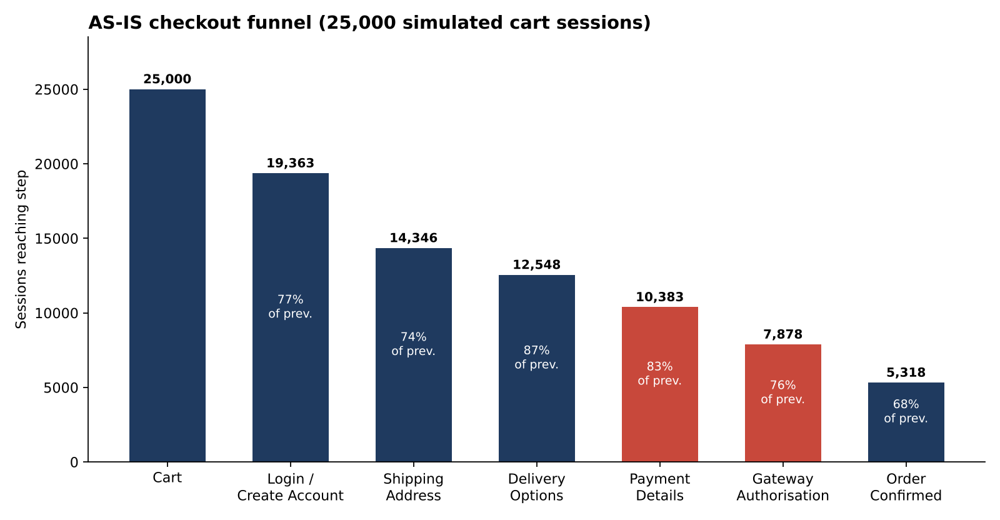
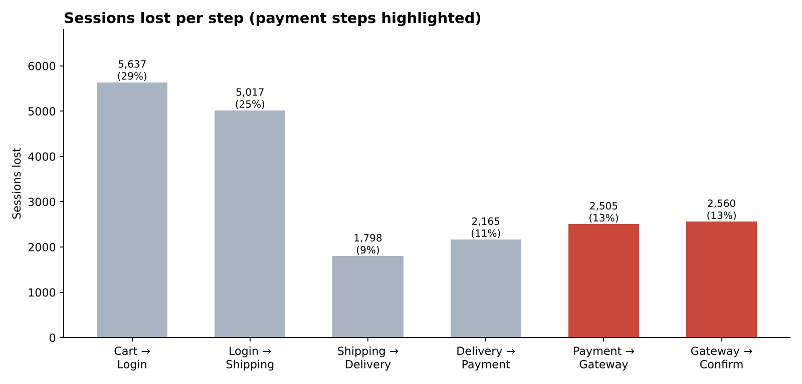
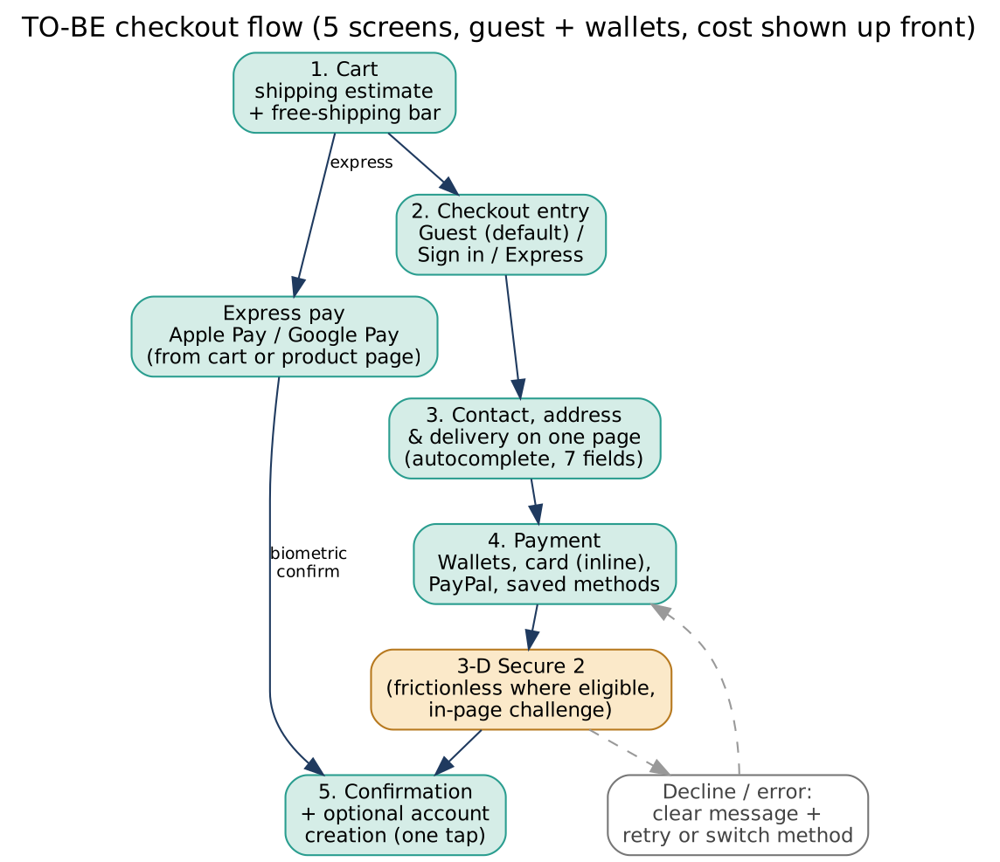

# E-Commerce Checkout Optimisation: Funnel Analysis, BRD and User Stories

> A business analysis case study on why an online store loses shoppers at the payment stage, and what to change about it.
> **Data note:** the store, the dataset and every figure are simulated for this portfolio project. The method is the real part.



## The problem

An online store is seeing a high cart-abandonment rate around payment. Out of every 100 shoppers who reach the cart, about 79 leave before ordering. The business asked two things: *where* are we losing people, and *what should we build to win them back?*

## What I did

| Step | Output | File |
|---|---|---|
| Mapped the current checkout and designed a better one | AS-IS and TO-BE process flows | [images/05_as_is_flow.png](images/05_as_is_flow.png), [images/06_to_be_flow.png](images/06_to_be_flow.png) |
| Analysed 25,000 cart sessions with SQL | 9 funnel and segment queries | [sql/02_funnel_analysis.sql](sql/02_funnel_analysis.sql) |
| Rebuilt the analysis in Excel with live formulas | Funnel, segments, exit reasons, what-if model | [analysis/Checkout_Funnel_Analysis.xlsx](analysis/Checkout_Funnel_Analysis.xlsx) |
| Wrote the Business Requirements Document | 11 business reqs, 16 functional, 8 non-functional, risks, KPIs, rollout | [docs/BRD_Checkout_Optimisation.docx](docs/BRD_Checkout_Optimisation.docx) |
| Turned requirements into a backlog | 15 user stories with Given/When/Then criteria | [docs/User_Stories.md](docs/User_Stories.md) |

## What the data says

| Step | Reached | Lost at step | Drop rate | Share of all lost sessions |
|---|---:|---:|---:|---:|
| 1 Cart | 25,000 | 5,637 | 22.5% | 28.6% |
| 2 Login / create account | 19,363 | 5,017 | 25.9% | 25.5% |
| 3 Shipping address | 14,346 | 1,798 | 12.5% | 9.1% |
| 4 Delivery options | 12,548 | 2,165 | 17.3% | 11.0% |
| **5 Payment details** | 10,383 | 2,505 | 24.1% | 12.7% |
| **6 Gateway authorisation** | 7,878 | 2,560 | **32.5%** | 13.0% |
| 7 Order confirmed | 5,318 | - | - | - |

**Overall conversion: 21.3%.**

1. **Payment is where the most committed shoppers are lost.** 48.8% of the 10,383 sessions that reached payment never completed, about $424K of cart value in the quarter. The final step has the worst drop rate in the whole funnel.
2. **Mobile is the weak spot.** Mobile is 62% of traffic but converts at 16.9% against 29.5% on desktop. Only 61% of mobile sessions get through the gateway.
3. **The account wall is the second leak, and worth flagging.** The biggest single loss in raw numbers happens before payment: new customers pass the login step at 66% versus 88% for returning customers.
4. **The gateway exits have clear causes.** 3-D Secure timeouts and failures (34%), declined cards (23%) and gateway errors or expired sessions (27%) make up most of them.
5. **Smaller contributors:** late delivery-cost reveal (paid-shipping pass rate 76% vs 91% for free), slow payment pages (68% pass above 4.5 sec vs 81% under 3 sec), and 29% of payment-form exits tagged "wanted a wallet option".



## Recommendation

Cut the flow from seven screens to five:

- Guest checkout by default, with account creation offered after purchase
- Delivery estimate and free-shipping progress bar in the basket
- One page for contact, address and delivery (12 fields down to 7)
- Apple Pay and Google Pay, plus inline card fields built for phones
- In-page 3-D Secure 2, clear decline messages, retry, and no duplicate charges
- A performance budget for the payment page and step-level tracking



**Estimated impact (assumption-based):** with cautious recovery rates and a 15% haircut for overlap, conversion moves from 21.3% to about 26.4%, roughly 1,290 extra orders and $110K extra revenue per quarter. The pessimistic case (half the assumed recovery) still gives about $55K. These are planning assumptions, so the BRD calls for phased A/B tests (about 6,800 sessions per arm to detect a 2-point lift) before committing to targets.

## Repository structure

```
├── README.md
├── data/checkout_sessions.csv          # 25,000 simulated sessions
├── sql/
│   ├── 01_create_and_load.sql          # table definition and load commands
│   ├── 02_funnel_analysis.sql          # 9 analysis queries
│   └── run_in_sqlite.py                # runs all queries locally
├── analysis/Checkout_Funnel_Analysis.xlsx
├── docs/
│   ├── BRD_Checkout_Optimisation.docx
│   ├── User_Stories.md
│   ├── as_is_flow.dot / to_be_flow.dot # Graphviz sources for the flows
├── images/                             # charts and flow diagrams
└── scripts/                            # dataset, charts, workbook and BRD builders
```

## Run it yourself

```bash
pip install -r requirements.txt
python scripts/generate_dataset.py     # rebuild the CSV (seeded, so it is repeatable)
python sql/run_in_sqlite.py            # run every SQL query
python scripts/make_charts.py          # refresh the charts
python scripts/build_workbook.py       # rebuild the Excel file
```

## How the dataset was built

I could not use a real company's data, so `scripts/generate_dataset.py` simulates sessions with a fixed random seed. Each step has a pass probability that depends on device, customer type, shipping cost and page speed. The base rates are assumptions chosen to look like a typical store (industry benchmarks put average cart abandonment near 70%). It is a teaching dataset, so conclusions about *this* data illustrate the method and do not describe any real business.

## Skills shown

Process mapping (AS-IS / TO-BE) · requirements elicitation and documentation (BRD) · user stories and acceptance criteria · MoSCoW prioritisation · SQL (CTEs, window functions, conditional aggregation) · Excel (COUNTIFS/SUMIFS, scenario modelling, charts) · funnel and segmentation analysis · KPI definition · A/B test design · risk and stakeholder analysis · traceability.

## Possible next steps

- Wireframes of the five TO-BE screens
- Dashboard of the funnel in Power BI or Tableau
- A short stakeholder presentation of the findings

## Author

**Aditya Yadav**, Business Analyst  |  [LinkedIn](https://www.linkedin.com/in/aditya-lnk)
